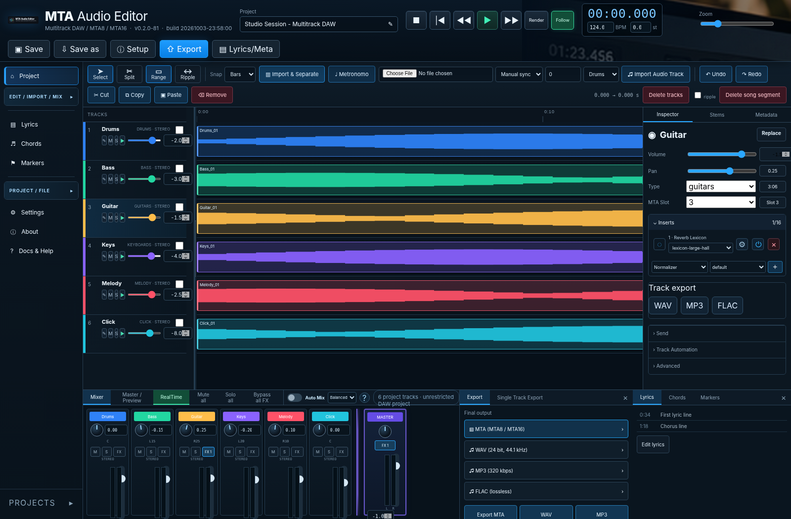

> **2026-10-21 CI maintenance / Manutenzione CI:** Fixed 15 reported Ruff findings in isolated tests (unused imports, mocked path literals and deterministic random input), without suppressing project lint rules. Focused verification: 47 passed. Multi-instrument 10–16 quality remains **unverified and open**, awaiting authorized model weights and labeled representative audio/MIDI.

**Verifica corrente r210, 21 ottobre 2026:** 4,735 casi distinti verificati tra regressione completa e riesame finale dei casi falliti; 98 saltati. Verificati Qixuan IT/FR sulla banca esistente, zoom UI nativo, progetti audio/MIDI, transport/metronomo musicale e quantizzazione. Dodici inferenze CPU Qixuan riuscite; IT/FR restano proiezioni tra lingue. [Resoconto bilingue corrente](docs/R210_QIXUAN_MIDI_NATIVE_IT_EN.md). Restano distinti i collaudi reali/d’ascolto e il precedente obiettivo di accuratezza su 10–16 strumenti. Le verifiche precedenti riportate sotto sono storiche.

**Verifica corrente r210, 21 ottobre 2026:** 4.680 test superati, zero errori, 98 saltati. Corretti il link alle tariffe e la gestione dei singoli file AI per motore. Otto inferenze CPU ONNX riuscite con i profili Qixuan IT/FR, dichiarati come proiezioni tra lingue. **L’accuratezza su 10–16 strumenti resta irrisolta: non mancano soltanto collaudi hardware.** [Resoconto bilingue corrente](docs/R210_ADMIN_QIXUAN_ACCURACY_IT_EN.md). Le precedenti verifiche riportate sotto sono storiche.

**Current r210 verification, 21 October 2026:** 4598 passed, 0 failures/errors, 98 skipped. Fixed combined Deep channel/controller routing, empty-score handling, source-duration note bounds and final cancellation. [Current bilingual report](docs/R210_COMBINED_RESULTS_IT_EN.md) · [Runtime/target acceptance guide](docs/R210_DIFFSINGER_DEEP_ACCEPTANCE_IT_EN.md). Multi-instrument accuracy and Qixuan IT/FR remain open; this is not full three-area certification. Earlier checkpoints below are historical.

**21 October 2026 — current r210 verification:** 4,608 passed, 0 failed, 80 skipped, 6 warnings (524.10 s). Final changed-area checks: 68 passed; the last vocal identity adjustment also passed real Qixuan→YourMT3 PS inference. Real DiffSinger ONNX singing and the metered Deep pipeline/replay now work. The ten–sixteen instrument accuracy gate remains unmet and is not a hardware-only limitation. See [current bilingual report](docs/R210_DIFFSINGER_DEEP_CLOSURE_IT_EN.md) and [acceptance guide](docs/R210_DIFFSINGER_DEEP_ACCEPTANCE_IT_EN.md). Version remains 0.3.0-r210.

**Final general regression / Regressione generale finale: 4.596 passed, 0 failed, 80 skipped, 6 warnings.**

**Verifica runtime corrente, 21 ottobre 2026 — 0.3.0-r210:** concluse vere inferenze CPU offline RVC, Seed-VC con controllo rigoroso, Transkun e YourMT3; banca FluidR3/TinySoundFont reale verificata su 128 programmi GM e 47 suoni di batteria. Corretti import RVC, compatibilità checkpoint e headroom di esportazione/resampling Seed. Il mix di dieci programmi YourMT3 **non raggiunge il target** (5 parti predette); mancano una banca DiffSinger completa autorizzata e i collaudi browser/sistema. **Non restano soltanto verifiche hardware.**

[Resoconto bilingue corrente](docs/R210_REAL_RUNTIME_HANDOFF_IT_EN.md) · [Passi di collaudo e blocchi residui](docs/R210_TARGET_ACCEPTANCE_IT_EN.md) · [Commit cumulativo suggerito](docs/COMMIT_MESSAGE_R210.txt).

Le verifiche precedenti riportate sotto sono cronologiche; per i controlli ripetuti prevale il resoconto corrente.

---

**Stato corrente, 21 ottobre 2026 — 0.3.0-r210:** regressione generale offline conclusa: **4.579 passati, 0 falliti, 85 saltati, 6 warning**. Corretta la selezione remota delle tracce lead/backing; riallineati i test legacy e aggiunto isolamento offline senza allentare autenticazione o licenze. Restano bundle neurali completi autorizzati, benchmark musicale e accettazione con asset/browser/hardware; non si dichiarano completate tutte le macroaree.

[Final bilingual report](docs/R210_OFFLINE_FINALIZATION_IT_EN.md) · [Cumulative suggested commit](docs/COMMIT_MESSAGE_R210.txt).

---


### r210 verifica tecnica in ciclo unico (21 ottobre 2026)
Il recupero da checkpoint Audio-to-MIDI con schema non valido ora riesegue lo stadio reale invece di fallire; 108 test offline trasversali superati. Inferenze neurali con asset autorizzati, regressione generale e collaudi browser/native/GM reali restano **non verificati**, quindi le tre macroaree **non sono certificate complete**. Vedi `docs/DEVELOPMENT_STATUS.md`.

**r210 three-area verification (2026-10-21):** GM atomic WAV export and validated MIDI benchmark instrument target; 101 passed, 0 failed, 5 skipped in an offline subset. The three macroareas are **not yet end-to-end certified**. See `docs/R210_THREE_AREAS_CLOSURE_GATE_20261021_IT_EN.md`.

Verifica aggiuntiva: 106 superati, 0 falliti, 5 saltati (suite offline mirata, non regressione generale). Le tre macroaree non sono ancora certificate end-to-end; vedere `validation/r210-finalization-current.json`. 


> Rafforzamento offline r210: limite alle scansioni del benchmark MIDI e riconfigurazione GM disabilitata dopo la chiusura; 123 test mirati superati, 10 saltati per asset/DOM. Inferenze neurali, regressione generale e accettazione target non certificate.


## r210 benchmark provenance follow-up — 21 October 2026

Implemented: Audio-to-MIDI benchmark file reports now record SHA-256 hashes and exact byte lengths of both local MusicResult inputs. This supports reproducibility but does not certify real neural inference or reviewed reference labels. Offline regression: **73 passed, 0 failed, 9 skipped** (requires externally reviewed GM assets/core). The controlled full suite has not been rerun and prior GitHub-request governance blocker is unresolved. No real checkpoint inference, native/browser acceptance or musical listening was performed. No production server changes and no Git operations. **The three macroareas are not signed off; software completion cannot be certified yet.**

## r210: sicurezza del recupero locale degli stadi

La stessa istanza di cache degli stadi ora invalida i risultati precedenti quando cambia l’impronta di runtime/modello/policy. Test locali: 28 superati, 0 falliti, 0 saltati; regressione r210 estesa interrotta prima del riepilogo finale. Inferenze neurali e collaudo browser/native non certificati. Vedere `docs/DEVELOPMENT_STATUS.md`.

## Checkpoint cumulativo delle tre macroaree (0.3.0-r210, non committato)

## r210 — Asset neurali, conversione e recupero trascrizione (non committato)

Registro con SHA-256 e licenze per componente, voicebank DiffSinger indipendenti, testo completo IT/EN/FR e melismi, curve espressive e rigenerazione parole/sillabe/frasi, CLI reali RVC/Seed-VC, Transkun piano e recupero degli stadi Approfondita senza doppio addebito. Nessun modello o diritto è inventato; inferenze con checkpoint autorizzati e collaudi musicali restano da eseguire. GM verificato con runtime reali; dettagli e risultati effettivi in [stato sviluppo](docs/DEVELOPMENT_STATUS.md) e [guida IT/EN](docs/STUDIO_MANAGED_ASSETS_R210_IT_EN.md).

Aggiunti il percorso completo dei testi IT/EN/FR fino a DiffSinger, G2P reale opzionale eSpeak NG con profilo IPA/inventario specifico della voicebank verificato con SHA-256, sillabe multifonema, curva F0 obbligatoria, vibrato, preset espressivi e inviluppi di dinamica. Il checkpoint acustico viene selezionato esattamente; configurazione e vocoder sono verificati, con autorizzazione distinta del vocoder. La rigenerazione di un intervallo crea una take allineata e conserva i metadati di ogni cantante.

La modalità Audio-to-MIDI Approfondita esegue separazione Demucs e trascrizione/riconciliazione YourMT3 e Basic Pitch per sorgente. Mantiene parti con uguale programma GM senza confondere sorgenti separate con voti indipendenti dei modelli; nessuna garanzia di accuratezza su 10–16 strumenti. SoundFont locali autorizzati possono essere installati con hash del banco e della licenza e selezionati nell’editor. Il motore TinySoundFont ha generato audio reale per tutti i 128 programmi GM e tutte le 47 note percussive standard, con prove di controller e temporizzazione SMF.

**Le tre macroaree non sono ancora complete dal punto di vista software.** Restano conversione timbrica, gestione indipendente delle voicebank neurali, altri trascrittori specialistici, gestione degli stem senza note e chiusure avanzate UI/client. Qui non è stata eseguita inferenza reale DiffSinger/YourMT3. Sorgenti, integrazioni legacy, SDK VST e file originali sono conservati. Versione invariata, nessuna operazione Git o sui server. Vedere [implementazione e configurazione server](docs/THREE_AREA_IMPLEMENTATION_R210_IT_EN.md), [stato aggiornato](docs/DEVELOPMENT_STATUS.md) e report di validazione inclusi. DiffSinger ora richiede configurazione flattened verificata e vocoder autorizzato separatamente.

Per installare il server web MTA su Linux, usa il [wizard di installazione MTA](MTA_INSTALLATION.md): `scripts/install_mta.sh` installa l’app e verifica l’accesso via browser, senza richiedere il checkout completo.

## Wizard di installazione ACE-Step

Per installare ACE-Step su Linux Debian/RHEL (fisico, VM o LXC) basta scaricare il singolo `scripts/install_ace_step.sh`: **non è necessario** clonare il repository. Consulta la [guida di installazione ACE-Step](ACE_STEP_INSTALLATION.md) per requisiti GPU, firewall, versione, reinstallazione e disinstallazione.

### 0.3.0-r154 — Validated bounded batch event IPC (native host disabled)

The event-enabled persistent VST3 worker can now prevalidate entire batches (up to 128 PCM blocks / 65536 frames), including MIDI and parameter offsets, before any IPC is sent. Real ADelay validation covers irregular stereo blocks and automation. This is a control/worker-thread offline API only; native_host_ready remains false.


### 0.3.0-r153 — Experimental VST3 event IPC (native host remains disabled)
Persistent offline VST3 IPC optionally accepts bounded MIDI note-on/off and normalized parameter changes per PCM block, with sample offsets. The legacy PCM stream is unchanged. Events are validated and mapped into Steinberg EventList/ParameterChanges on the isolated worker process. This is not an enabled realtime host.

## r141–r150 — Bounded worker event dispatch (experimental)

Added `native/audio_core/vst3_event_dispatch.hpp`: epoch/sequence gating, bounded MIDI and parameter dispatch, atomic prevalidation, preserved sample offsets, failure counters, lifecycle reset, and deterministic sequence consumption. The worker adapter is not yet wired to Steinberg SDK processing or production playback. `native_host_ready=false`.

r122 experimental native C ABI to real VST3 IPC acceptance is available for tests only. Production playback remains unchanged; `native_host_ready=false`.

Experimental r121 native audio core C ABI available; VST3 realtime host remains disabled (`native_host_ready=false`).

### r70 — Experimental interactive VST3 offline worker

`native/vst3_probe/stream_worker.py` implements `NativeVST3Worker` (persistent IPC
per plugin) and `render_stream_wav()` (bounded-memory PCM16/24/32 WAV export).
The C++ probe's `--stream-pcm <CID> <channels> <rate>` protocol exchanges
little-endian uint32 frame counts plus interleaved Float32 PCM on stdin/stdout,
1–512 frames at a time; zero frames signals graceful shutdown. This is not a
realtime callback-safe integration. A Python watchdog kills stalled workers,
rejects malformed/nonfinite replies, and leaves preexisting WAV outputs intact
on export errors. Supported sample rates: 44100, 48000, 96000; mono/stereo.
The real ADelay streaming and session acceptance tests run in Linux VST3 SDK CI.
Read `native/vst3_probe/READINESS_GATES.md` before enabling the native host.
**`native_host_ready=false` remains intentional.**

### Sessione offline VST3 sperimentale — r60

Il probe nativo può ora elaborare più richieste PCM consecutive durante una sola attivazione del plugin, mantenendone lo stato fra richieste. Le API Python `render_native_session()` e `render_native_session_chain()` sono sperimentali e non devono essere utilizzate nel callback audio realtime. Non si tratta ancora di un demone interattivo persistente. Consultare `VST3_HOST_SETUP.md`.

# MTA Audio Editor 0.2.0




Web DAW containerizzata per creare, importare, modificare ed esportare progetti multitraccia MTA destinati a M-Live/Merish ed equivalenti.

Alessandro De Salvo <braket71@gmail.com>  
**Repository:** `desalvo/mta-audio-editor`  
**Licenza:** EUPL-1.2  
**Versione:** `0.2.0`  
**Revision:** `153`  
**Build:** generato automaticamente nel formato `YYYYMMDDhhmmss`.


## Manuali PDF / PDF manuals

**Italiano**
- [Manuale utente PDF](app/docs/MTA-Audio-Editor-User-Manual-IT.pdf)
- [Manuale amministratore PDF](app/docs/MTA-Audio-Editor-Administrator-Manual-IT.pdf)

**English**
- [User Manual PDF](app/docs/MTA-Audio-Editor-User-Manual-EN.pdf)
- [Administrator Manual PDF](app/docs/MTA-Audio-Editor-Administrator-Manual-EN.pdf)


## Brochure e specifiche MTA

- [Brochure prodotto PDF - Italiano](app/docs/MTA-Audio-Editor-Brochure-IT.pdf)
- [Product Brochure PDF - English](app/docs/MTA-Audio-Editor-Brochure-EN.pdf)
- [Specifica completa formato MTA PDF - Italiano](app/docs/MTA-Audio-Editor-MTA-Format-Specification-IT.pdf)
- [Complete MTA Format Specification PDF - English](app/docs/MTA-Audio-Editor-MTA-Format-Specification-EN.pdf)
- [README principale - English](README.md)

## Funzioni principali

- timeline grafica multitraccia in stile DAW con waveform e zoom;
- selezione e rimozione di segmenti su una o più tracce;
- taglio globale del brano con riallineamento di tutte le tracce e degli eventi temporali;
- ripple editing opzionale sulle tracce selezionate;
- editing non distruttivo basato su clip/regioni;
- import di nuove tracce e sostituzione di tracce esistenti;
- sincronizzazione manuale in millisecondi e automatica tramite correlazione dell'inviluppo audio;
- interfaccia DAW professionale e responsive; gli screenshot della documentazione sono acquisiti dall’applicazione reale;
- mixer con fader, pan, mute, solo, meter e master bus;
- import diretto di MP3/WAV e sostituzione di singole tracce;
- separazione MP3 in stems indipendenti tramite plugin Demucs, da aggiungere a un MTA esistente o nuovo;
- catene insert per traccia e master, fino a 16 effetti, con preset factory e preset custom persistenti: EQ parametrico/32-band, normalizer, compressor, limiter, delay, Lexicon-style reverb, room/ambience, amplify, stereo imager, maximizer/loudness, mastering wizard, de-noise e crackling cleaner;
- wizard globale **Auto Mix** reversibile con toggle e profili Balanced/Studio/Live/Gentle;
- preview master renderizzata applicando timeline, insert, mixer e processing master;
- export MTA8/MTA16, WAV PCM 24-bit/44.1 kHz, MP3 320 kbps e FLAC lossless;
- gestione testo, accordi e marker temporali;
- preservazione degli attachment MTA esistenti quando estraibili;
- estrazione read-only del MIDITK proprietario come file MIDI standard scaricabile dal progetto;
- documentazione utente e amministratore integrata e scaricabile in PDF.


## Gestione utenti e autenticazione

L'applicazione usa autenticazione multi-utente persistente su SQLite nel volume `/data/projects`. La schermata iniziale di login riprende fedelmente il mockup approvato, con layout fotografico/glassmorphism e variante responsive per smartphone.

- registrazione autonoma con **email obbligatoria**;
- conferma email tramite link prima di qualunque attivazione;
- approvazione/disattivazione degli account riservata agli amministratori;
- ruoli `admin` e `user`;
- TOTP opzionale RFC 6238 attivabile dal profilo, con QR code generato internamente;
- cambio email con nuova conferma e nuova approvazione;
- cambio/reset password;
- gestione SMTP/STARTTLS/SMTPS dal pannello amministrativo, con credenziali opzionali;
- password SMTP cifrata sul volume tramite chiave applicativa locale;
- notifica email a tutti gli amministratori con email confermata quando un utente viene attivato.

Al **primo avvio** devono essere definiti `MTA_ADMIN_USERNAME`, `MTA_ADMIN_PASSWORD` e `MTA_ADMIN_EMAIL`; questi valori creano il primo account amministratore. Per i link email dietro reverse proxy è raccomandato `MTA_PUBLIC_URL=https://mta.example.com`.

### Login social (Google, Facebook, GitHub)

I login OAuth social sono predisposti ma **disabilitati per default**. Gli utenti creati tramite provider social hanno email già verificata dal provider ma restano disabilitati fino all’approvazione di un amministratore; l’approvazione invia automaticamente una mail all’utente. Configurazione completa, callback e variabili Docker/Kubernetes: [`docs/SOCIAL_LOGIN.md`](docs/SOCIAL_LOGIN.md).

## Avvio Docker

```bash
export MTA_ADMIN_PASSWORD='una-password-lunga-e-casuale'
export MTA_ADMIN_EMAIL='admin@example.com'
docker compose up -d --build
```

La build production include per default il plugin Demucs. Per un’immagine core più piccola senza stem separation: `docker build --build-arg INSTALL_STEMS=false .`.

Aprire `http://localhost:8080`. L'autenticazione è abilitata per default. Al primo avvio l'account bootstrap viene creato solo se sono presenti password ed email amministrative; **non esistono credenziali predefinite**.


## Workspace utenti, condivisione e archivi completi

Ogni utente vede un workspace dedicato contenente i progetti di cui è proprietario e quelli condivisi con lui. Il proprietario può condividere un progetto con un altro account attivo e con email confermata; il collaboratore può aprire e modificare il progetto, mentre condivisioni ed eliminazione del progetto restano riservate al proprietario (o a un amministratore).

Per ogni progetto è disponibile una gestione file con elenco, download, upload di file originali aggiuntivi e cancellazione dei file non referenziati. Gli upload audio e i file MTA importati vengono conservati anche nella directory `originals/` del progetto, così i dump contengono sia lo stato corrente sia i file originari.

È possibile:
- esportare un intero progetto come archivio `.maeproj`;
- importare un archivio progetto completo, che viene assegnato all'utente che lo importa;
- esportare/importare normalmente MTA, audio e singole tracce;
- come amministratore, scaricare un dump ZIP di tutti i progetti di tutti gli utenti tramite il pannello utenti.

Gli archivi completi includono `project.json`, audio, attachment, sorgente MTA, file originali e gli altri artefatti presenti nel progetto.

## Kubernetes / Kustomize

I manifest sono separati in `k8s/base/namespace.yaml`, `pvc.yaml`, `deployment.yaml` e `service.yaml`. `secret.example.yaml` è volutamente escluso dal Kustomization di base. Sono inclusi due overlay di esempio:

```bash
kubectl apply -k k8s/overlays/nginx
kubectl apply -k k8s/overlays/haproxy
```

Per generare manifest locali personalizzati è disponibile un wizard standalone auto-aggiornante:

```bash
curl -fsSLo mta-k8s-wizard.py \
  https://raw.githubusercontent.com/desalvo/mta-audio-editor/main/scripts/k8s-wizard.py
python3 mta-k8s-wizard.py
```

Il wizard propone prima i default e nei run successivi gli ultimi valori usati. Il limite di upload predefinito è **1024 MB** ed è applicato sia all'applicazione sia alle annotazioni Ingress; può essere modificato interattivamente o con `--max-upload-mb <MB>` e `--image-pull-policy Always|IfNotPresent|Never`. Richiede username/password amministrativi, StorageClass del PVC, namespace e `nodeSelector`; consente inoltre di scegliere Ingress NGINX/HAProxy/nessuno, host e immagine. La configurazione locale usa permessi `0600`; usare `--no-save-password` per non persistere la password. Se trova una versione del wizard più nuova su GitHub aggiorna atomicamente il proprio file e si riavvia automaticamente.

## Android e iOS/iPadOS

Il repository include client nativi in `mobile/android` e `mobile/ios`. Le app mobile si collegano via HTTPS al backend MTA Audio Editor Docker/Kubernetes, riutilizzano l'interfaccia responsive e aggiungono integrazione nativa con Files/Storage Access Framework per import, export, scelta destinazione e condivisione. Al primo avvio usano automaticamente il servizio preconfigurato: non viene richiesto alcun URL e l'indirizzo predefinito non viene mostrato. Un URL personalizzato può essere impostato successivamente nelle Impostazioni server; solo il valore custom può essere visualizzato/modificato dall'utente. Demucs, rendering FFmpeg e generazione MTA restano server-side. La CI produce APK/AAB Android e un archivio iOS; con i secret di firma produce anche AAB/IPA distribuibili e può inviare l'IPA a TestFlight sui tag. Vedi `docs/MOBILE_APPS.md`.

## Documentazione

### Mappa della documentazione

| Documento | Contenuto |
|---|---|
| `app/docs/MTA-Audio-Editor-User-Manual-IT.pdf` / `-EN.pdf` | manuale utente completo italiano/inglese con screenshot, esempi e workflow |
| `app/docs/MTA-Audio-Editor-Administrator-Manual-IT.pdf` / `-EN.pdf` | amministrazione, sicurezza, architettura, mobile e specifica MTA |
| `docs/MTA_FORMAT_FINAL_SPEC_IT.md` / `docs/MTA_FORMAT_FINAL_SPEC_EN.md` | specifica tecnica MTA consolidata IT/EN |
| `docs/MTA_FORMAT_FINAL_SPEC.md` | alias inglese della specifica tecnica consolidata |
| `docs/MTA_FORMAT_RESEARCH.md` | note tecniche e cronologia di validazione del formato |
| `docs/PROJECT_ARCHITECTURE.md` | architettura software e flussi end-to-end |
| `docs/DATA_MODEL.md` | modello dati e persistenza |
| `docs/API_REFERENCE.md` | mappa API e convenzioni HTTP |
| `docs/OPERATIONS_RUNBOOK.md` | esercizio, Kubernetes, backup, troubleshooting |
| `docs/TESTING_AND_RELEASE.md` | test, CI/CD e criteri di release |
| `docs/SECURE_DEVELOPMENT.md` | regole di sviluppo sicuro |


- `/docs/user` - manuale utente online, pubblico;
- `/docs/pdf/user` - manuale utente PDF;
- `/docs/admin` - manuale amministratore, protetto da autenticazione;
- `/docs/pdf/admin` - manuale amministratore PDF, protetto da autenticazione;
- `docs/SECURE_DEVELOPMENT.md` - baseline di sviluppo sicuro.
- `docs/PROJECT_ARCHITECTURE.md` - architettura progettuale, moduli, flussi dati e policy di release.
- `docs/MTA_FORMAT_RESEARCH.md` - note di validazione tecnica del formato MTA e limiti di compatibilità.

## CI/CD GitHub

La pipeline `.github/workflows/ci-cd.yml` applica i gate prima di pubblicare immagini:

1. compile + Ruff;
2. unit/integration test e coverage minima 70%;
3. Bandit SAST;
4. `pip-audit` sulle dipendenze Python;
5. Gitleaks;
6. Trivy filesystem scan;
7. build immagine locale;
8. Trivy image scan;
9. smoke test autenticato e verifica delle route pubbliche/protette.

Solo dopo il superamento dei gate:

- push su `main` -> `desalvo/mta-audio-editor:latest`;
- push di un tag -> `desalvo/mta-audio-editor:<tag>`.

Le immagini sono pubblicate per `linux/amd64` e `linux/arm64`, con provenance e SBOM BuildKit.

### Secret GitHub richiesti

Definire come **Repository secrets**:

- `DOCKERHUB_USERNAME`
- `DOCKERHUB_TOKEN`

## Primo push e release

```bash
git init
git branch -M main
git remote add origin https://github.com/desalvo/mta-audio-editor.git
git add .
git commit -m "Release 0.2.0 revision 153"
git push -u origin main
```

Dopo che la CI su `main` è verde, creare il tag:

```bash
git tag -s v0.2.0 -m "MTA Audio Editor 0.2.0"
git push origin v0.2.0
```

## Packaging locale

`./scripts/package.sh` aggiorna automaticamente `BUILD_INFO`, rigenera i PDF, esegue i production gate, rimuove cache/artefatti temporanei e genera lo ZIP versionato.

## Sicurezza e produzione

L'applicazione applica autenticazione default-on, request-integrity header sulle operazioni mutative, confinamento dei path, limiti upload, validation dei media, security header, container non-root/read-only e gate di sicurezza CI. Questo costituisce una baseline production-oriented, non una certificazione formale. TLS, secret management, backup, monitoring, network policy e validazione su hardware Merish restano responsabilità del deployment.

## Compatibilità MTA

Il layer container/import-export è isolato in `app/codec.py`; l'analisi proprietaria è isolata in `app/mta_reverse.py`. Gli attachment non audio già presenti vengono preservati quando tecnicamente estraibili e l'editor aggiunge `mta-editor.json` con il modello non distruttivo.

Sul corpus attuale di quattro file stock M-Live sono verificati in sola lettura: ID3v2.3, MtxInfoData XML, LYRICS/CHORDS temporizzati, COLORS con timing a centesimi e posizione progressiva di highlighting, e MIDITK ricostruito come Standard MIDI byte-exact con marker/tempo. Le sezioni condividono una keystream di 256 byte recuperabile dal file stesso. I campi ancora non documentati (per esempio alcuni sentinel COLORS) vengono riportati senza attribuire una semantica di scrittura.

La scrittura dei payload proprietari stock resta intenzionalmente disabilitata finché file controllati non vengono accettati da hardware M-Live/Merish reale. Il MIDI ricostruito da MIDITK viene salvato come sidecar nella directory di format-analysis ed è scaricabile tramite `GET /api/projects/{pid}/mta-miditk`. Vedere `docs/MTA_FORMAT_RESEARCH.md`.


## 0.2.0-3: extended mix, MTA slot mapping and format analysis

A project is no longer constrained to the final MTA8/MTA16 slot count while editing or mixing. You may keep any practical number of project tracks. MTA8 still exports at most 8 slots and MTA16 at most 16; when the project exceeds that capacity the export dialog requires every project track to be assigned to an output slot. Multiple tracks assigned to one slot are rendered and mixed into that single MTA stream with their inserts, fader, pan, mute and solo state applied.

Single tracks can be exported independently as WAV (24-bit), MP3 (320 kbps) or FLAC. The stereo master can also be exported as FLAC in addition to WAV/MP3.

Imported MTA files are analyzed by the MTA format parser (`app/mta_reverse.py`). It inventories Matroska streams/tags and attachments, fingerprints opaque payloads, parses embedded ID3v2.3 and MtxInfoData XML, and inspects the proprietary `LYRICS`, `CHORDS`, `COLORS` and `MIDITK` families. Corpus analysis now provides validated read-only decoding: LYRICS/CHORDS expose readable strings and minute/centisecond timestamps; COLORS exposes the 15-byte event layout, exact timing and progressive highlight position; MIDITK reconstructs byte-exact Standard MIDI and extracts tempo/Marker meta-events. Unknown fields and undocumented writer semantics remain preserved rather than rewritten speculatively.


## Python and dependency policy

La baseline production e CI è **Python 3.14**. Questa release assorbe la precedente PR Docker verso `python:3.14-slim-bookworm` e abilita NumPy 2.5.3, che supporta Python 3.12-3.15. Il plugin stems usa Demucs 4.1.0; l'immagine verifica anche PyTorch 2.14.1, che pubblica wheel CPython 3.14 per amd64 e arm64. Dependabot può quindi aggiornare normalmente Python/NumPy entro questa baseline; Python 3.15 resta escluso finché PyTorch/Demucs e i gate multi-arch non vengono validati.

Il security job usa checkout Git completo per permettere a Gitleaks di analizzare correttamente le pull request Dependabot.

## 0.2.0-9: verified proprietary read-only decoding

The format-analysis layer now recovers the shared 256-byte keystream, decodes LYRICS/CHORDS timing and text, decodes COLORS timing plus progressive highlight position, and reconstructs MIDITK as byte-exact Standard MIDI with tempo/marker meta-events. These capabilities are read-only by design until controlled writer round-trips are validated on target M-Live/Merish hardware. See `docs/MTA_FORMAT_RESEARCH.md` for byte-level evidence and confidence boundaries.

## 0.2.0-4: extended insert suite and Auto Mix

The insert registry now includes Delay, Lexicon-style Reverb, Room/Ambience, 32-band Graphic EQ, Amplify, Stereo Imager, Maximizer/Loudness, Mastering Wizard, De-Noise and Crackling Cleaner. Every processor includes safe factory presets and validated user-custom parameters. User presets are persisted in the data volume and appear as `user:<name>` in every project.

Auto Mix is a reversible project-level wizard. Before applying its rules it snapshots track faders, pan, insert chains and master processing. The selected Balanced, Studio, Live or Gentle profile then applies conservative type-aware headroom, stereo placement, EQ/dynamics/space processing and a master preparation chain. Turning Auto Mix off restores the saved snapshot exactly.

`Lexicon-style` identifies a preset family/working style only: the implementation uses open FFmpeg processing and is not a proprietary Lexicon algorithm or emulation.


### Python 3.14 dependency compatibility

The 0.2.x Python 3.14 baseline pins Pydantic 2.12.5 for deterministic CPython 3.14 wheel resolution in GitHub Actions. NumPy remains 2.5.3 and Demucs 4.1.0.


### Kubernetes wizard: TLS termination

The manifest wizard supports TLS termination for NGINX and HAProxy Ingress. With HAProxy and TLS termination enabled it emits `haproxy-ingress.github.io/ssl-redirect: "true"`. When TLS termination is enabled, a `tls:` section is always generated: specify `--tls-secret <name>` to reference a Kubernetes TLS Secret, or leave it empty to use the Ingress Controller's default TLS certificate/secret.

## Multi-user authentication

MTA Audio Editor now uses application-managed users and a photographic, responsive login page. Self-registration requires a unique username, a mandatory email address and a password of at least 10 characters. The email must be confirmed before an administrator can activate the account. Only administrators can activate/deactivate users, change roles or delete other users.

The first administrator can be bootstrapped with `MTA_ADMIN_USERNAME`, `MTA_ADMIN_PASSWORD` and `MTA_ADMIN_EMAIL`. Each user can optionally enable TOTP from the profile page; the application generates the secret and an in-app QR code compatible with standard authenticator apps. SMTP/SMTPS/STARTTLS configuration is available to administrators under **Administration → SMTP / SMTPS** and is used for email confirmation plus activation notifications. When an account is activated, all active administrators with a confirmed email address receive a notification. Set `MTA_PUBLIC_URL` when the externally reachable application URL cannot be inferred from the incoming request/proxy.

### Social login (Google, Facebook, GitHub)

OAuth social providers are prepared but **disabled by default**. Social users receive a provider-verified email status but remain disabled until administrator approval; approval automatically sends the activation email. See [`docs/SOCIAL_LOGIN.md`](docs/SOCIAL_LOGIN.md) for provider callbacks and Docker/Kubernetes variables.

### Upgrade Kubernetes e readiness

Dalla 0.2.0-73 il pod imposta `fsGroup: 10001` e `fsGroupChangePolicy: OnRootMismatch` per rendere scrivibile il PVC all'utente applicativo non-root. La chiave `email` del Secret bootstrap è opzionale a runtime per mantenere compatibili gli upgrade da release precedenti; il wizard continua comunque a richiedere l'email per le nuove installazioni. È inoltre presente una `startupProbe` su `/api/health` prima di readiness e liveness.

Se un pod resta non Ready dopo un upgrade, controllare `kubectl describe pod` per `CreateContainerConfigError`, `permission denied` sul PVC o errori della probe.


## Edizioni native Windows e macOS

La stessa applicazione viene prodotta dalla CI anche come desktop nativo mono-utente:

| Piattaforma | Artefatto CI | Modalità |
|---|---|---|
| Windows x64 | `MTA-Audio-Editor-<version>-Windows-x64-Setup.exe` | installer per-user Inno Setup |
| macOS Intel | `MTA-Audio-Editor-<version>-macOS-x64.dmg` | `.app` drag-to-Applications |
| macOS Apple Silicon | `MTA-Audio-Editor-<version>-macOS-arm64.dmg` | `.app` drag-to-Applications |

Le edizioni native non espongono login o gestione utenti: sono applicazioni locali mono-utente. L'engine FastAPI resta interno all'applicazione e ascolta soltanto su `127.0.0.1`; l'interfaccia è visualizzata in una finestra `pywebview`. FFmpeg/FFprobe e lo stack Demucs/PyTorch vengono inclusi nel pacchetto; i modelli Demucs vengono scaricati al primo utilizzo e messi in cache nella directory dati dell'utente.

Persistenza:

```text
macOS   ~/Library/Application Support/MTA Audio Editor
Windows %LOCALAPPDATA%\MTA Audio Editor
```

Il workflow `.github/workflows/ci-cd.yml` esegue il build nativo dopo i gate Quality/Security, avvia l'eseguibile con `--native-smoke`, costruisce gli installer e ne pubblica gli artifact. Su un tag Git gli installer vengono inoltre aggiunti automaticamente alla GitHub Release.

> Gli installer generati dalla CI non sono firmati/notarizzati finché non vengono configurati certificati Apple/Windows nel processo di release. La firma del codice è distinta dalla validazione funzionale dell'applicazione.


---

# English

MTA Audio Editor is a DAW-style application for creating, importing, editing and exporting **MTA (Multi Track Audio)** projects. It can create new MTA8/MTA16 projects from audio tracks or separated stems, export the full project as MTA, WAV, MP3 or FLAC, and export individual tracks as WAV, MP3 or FLAC.

## PDF manuals

- [User Manual - English (PDF)](app/docs/MTA-Audio-Editor-User-Manual-EN.pdf)
- [Administrator Manual - English (PDF)](app/docs/MTA-Audio-Editor-Administrator-Manual-EN.pdf)
- [Manuale utente - Italiano (PDF)](app/docs/MTA-Audio-Editor-User-Manual-IT.pdf)
- [Manuale amministratore - Italiano (PDF)](app/docs/MTA-Audio-Editor-Administrator-Manual-IT.pdf)

## Main capabilities

- multitrack timeline with persistent waveforms, zoom and non-destructive clips;
- synchronized dynamic playback with buffering, Render preview, Follow and real-time meters;
- live mixer controls for level, pan, mute/solo and FX state;
- editable per-track MTA slot assignment plus device-aware MTA8/MTA16 mapping;
- insert FX with factory/user presets, immediate parameter refresh and synchronized rotary/numeric controls;
- stem separation through Demucs;
- project and individual-track exports;
- native Windows/macOS clients and Android/iOS/iPadOS clients.

The online/server and mobile editions use user accounts, optional TOTP and project sharing. Mobile apps rely on the cloud/remote server for heavy processing such as FFmpeg rendering, MTA generation and Demucs. Local native desktop single-user mode does not require those account features.
### Formati di progetto

- **Multitrack DAW**: formato progetto consigliato per editing/mix generale, senza limite MTA di 8/16 tracce. WAV/MP3/FLAC si esportano direttamente; per un export MTA si sceglie MTA8 o MTA16 in quella fase.
- **MTA8 / MTA16**: formati progetto orientati fin dall’inizio ai rispettivi limiti e profili hardware.


### Project formats

- **Multitrack DAW**: recommended general editing/mixing project format, without the MTA 8/16-track limit. WAV/MP3/FLAC export directly; MTA8 or MTA16 is selected only when an MTA export is requested.
- **MTA8 / MTA16**: project formats intended to follow the respective hardware/output limits from the start.

### Numero di stem configurabile
La separazione strumenti supporta il parametro **Auto / 2 / 4 / 6 / 8**. Auto è il default. 2 usa il profilo voce/accompagnamento, 4 il profilo standard, 6 il profilo esteso Demucs; 8 richiede un backend con modello 8-stem configurato. Su iPhone e iPad la build corrente delega Demucs al server, quindi lo stesso parametro è disponibile su entrambi i dispositivi senza caricare PyTorch nell’app.


## On-device Demucs on iPhone/iPad (0.2.0-97)

The iOS/iPadOS client can now run stem separation locally through Core ML. The mobile workflow exposes **Auto / Local / Server** execution. Auto prefers an installed local model and falls back to server-side Demucs when the requested model is unavailable or the local device constraints are exceeded. Core ML models are provisioned as `demucs-2.mlmodel`, `demucs-4.mlmodel`, `demucs-6.mlmodel`, or `demucs-8.mlmodel` from the configured backend and are compiled/cached in the app's Application Support directory for later offline use.

The local runtime decodes the selected audio on-device, converts it to stereo 44.1 kHz Float32 PCM, processes fixed-size overlapping chunks through Core ML using all available compute units (CPU/GPU/Neural Engine where Core ML supports them), overlap-adds the results, writes WAV stems, and uploads the resulting tracks into the current project. The current local safety limit is **12 minutes per source file**; longer material falls back to the server in Auto mode. On iPhone, Auto is intentionally more conservative than on iPad because of memory/thermal constraints.

Server administrators can expose compatible Core ML Demucs models by mounting a directory and setting `MTA_DEMUCS_COREML_MODEL_DIR`. The optional `scripts/export_demucs_coreml.py` utility documents the model contract expected by the app. Model conversion is a release-engineering step and must be validated for each Demucs architecture before publishing a model.

## Aggiornamenti delle applicazioni native

I client nativi Windows, macOS, Android, iPhone e iPad controllano GitHub per verificare la presenza di build più recenti. Il canale è configurabile nelle opzioni dell'applicazione:

- **Stable** controlla esclusivamente release/tag GitHub.
- **Early release** controlla anche la prerelease mobile `early-main`, rigenerata dall'ultima build valida di `main`.

Windows/macOS scaricano e avviano l'installer corrispondente; Android può scaricare l'APK e passarlo all'installer di sistema. iOS/iPadOS non può installare silenziosamente binari da GitHub: dopo conferma apre quindi il flusso autorizzato TestFlight/App Store o la distribuzione gestita.

### Ciclo di vita del modello Demucs locale su iPhone/iPad

Il client iOS/iPadOS prova sempre a rendere disponibile automaticamente un modello **Demucs Core ML 4-stem** predefinito. Viene preferito un modello validato incluso in `Models/demucs-default-4.mlmodel[c]`; in sua assenza l'app lo scarica automaticamente dal server MTA Audio Editor configurato. Gli hash SHA-256 dei modelli installati vengono confrontati con l'inventario autenticato del server e le versioni più recenti sostituiscono automaticamente quelle in cache. Il modello installato resta utilizzabile offline.

### Ciclo automatico modelli Demucs mobile
Docker/Kubernetes aggiorna automaticamente i modelli mobili dal manifest HTTPS configurato ogni 6 ore per default, verificandone SHA-256. iOS/iPadOS e Android controllano periodicamente il server. Il download dei modelli e attivo solo su Wi-Fi per default e puo essere abilitato anche su rete cellulare dalle preferenze. iOS usa Core ML; Android usa modelli ONNX Runtime Mobile.


## Separazione stem estesa model-driven

MTA Audio Editor non impone più un elenco fisso 2/4/6/8. Il server e i client mobili leggono dal catalogo/manifest le cardinalità realmente disponibili: 2, 4, 6, 8, 10, 12, 16 e anche valori superiori quando esiste un modello compatibile. Il limite tecnico di sicurezza corrente è 64 stem per singolo modello. I progetti Multitrack DAW non sono limitati dal numero di stem; i vincoli MTA8/MTA16 vengono applicati soltanto in export. I profili server aggiuntivi si configurano con `MTA_DEMUCS_MODEL_REGISTRY` o `MTA_DEMUCS_MODEL_REGISTRY_FILE`, dichiarando `model`, `stem_count`, `stem_labels` e opzionalmente `engine`/`display_name`.


### Demucs model catalogue / Catalogo modelli Demucs
The server periodically synchronizes all configured Demucs/Core ML/ONNX models. Native/mobile clients download requested models on demand, can delete or force-update local copies, and server administrators can blacklist models (which also removes managed server artifacts).

### Lyrics e chords sincronizzati
Dal menu contestuale di una traccia è possibile estrarre lyrics e chords sincronizzati nel progetto. I chords usano l'analizzatore cromatico integrato; le lyrics usano OpenAI Whisper, incluso nelle build production server/native. I pesi del modello Whisper vengono scaricati on-demand al primo utilizzo e mantenuti nella cache del runtime; vengono risolti direttamente dall'upstream/cache Whisper, non dal model server Demucs di MTA Audio Editor. Le lyrics sono scaricabili come testo semplice o PDF; il PDF mostra gli accordi sincronizzati sopra il testo e usa titolo/artista dai metadata del progetto. L'export MTA incorpora inoltre allegati lossless con timing in millisecondi per lyrics e chords.

### Rights repertoire lookup / Repertori società d’autori
Project Info can search selected rights societies (SIAE and Soundreef enabled by default), store multiple verified repertoire records for the same song across multiple rights providers, include all of them in MTA project metadata, display every stored record in Project Info, and export all available provider fields in both Lyrics + Chords PDF and ChordPro. Structured lookup uses authorized HTTPS endpoints configured with `MTA_RIGHTS_SIAE_SEARCH_URL` and `MTA_RIGHTS_SOUNDREEF_SEARCH_URL`; otherwise the official repertoire portal plus manual verified-result import is used. Lyrics + Chords can also be exported as ChordPro (`.cho`).

- Import audio da YouTube: avvia prima la riproduzione audio del video nel browser, poi copia e incolla l’URL di un singolo video `youtube.com`/`youtu.be` per aggiungerne l’audio come traccia del progetto (è richiesta la conferma di disporre dei diritti necessari).


### Lead Vocals / Backing Vocals
In **Importa e separa** è disponibile l’opzione per un secondo passaggio sullo stem vocale. Se `MTA_LEAD_BACKING_COMMAND` è configurato, il server usa il separatore AI indicato (placeholder supportati: `{input}`, `{lead}`, `{backing}`, `{output_dir}`); in assenza di un modello dedicato usa un fallback locale FFmpeg center/side. Il metodo usato viene registrato nel job.


### Lead / Backing Vocals AI models (0.2.0-124)
The dedicated vocal split uses `audio-separator==0.47.0` and downloads the selected karaoke model on demand. The default is `UVR_MDXNET_KARA_2.onnx`; Mel-RoFormer Karaoke Aufr33/Viperx and Gabox V2 are selectable for higher-quality/heavier processing. Web/server deployments cache weights under `${MTA_DATA_DIR}/.cache/lead-backing-models` (override with `MTA_LEAD_BACKING_MODEL_DIR`). Native desktop applications use the same mechanism against their local data directory, so model weights stay local. `MTA_LEAD_BACKING_DEFAULT_MODEL` changes the default model. The FFmpeg center/side method is an explicit fallback, not the default.

### Gestione modelli Lyrics e Chords

Dalla versione 0.2.0-126, i modelli Lyrics e Chords sono gestiti on-demand come gli altri modelli AI. Nella web app i pesi sono memorizzati sul server; nelle applicazioni native desktop sono memorizzati localmente. Per Lyrics è possibile scegliere tra i modelli OpenAI Whisper disponibili (default `base`). Per Chords è possibile scegliere il motore prima di ogni estrazione: Madmom Deep Chroma + CRF (default AI), Madmom CNN + CRF, Chordino / NNLS-Chroma oppure l'analizzatore MTA Chromagram. L'interfaccia mostra sempre il motore/modello effettivo e, per i checkpoint Madmom, la licenza CC BY-NC-SA 4.0 non-commerciale dei pesi.

### Editor waveform/campioni
Dalla waveform della timeline (doppio click) o dal menu contestuale di una traccia è disponibile un editor dedicato ad alta risoluzione. La selezione mostra i campioni esatti e consente Taglia/Copia/Incolla/Rimuovi. Sono disponibili processing in-place con preview A/B dinamica: Pitch Correction fine (semitoni + centesimi), Auto-Tune pitch-to-scale con tonalità/scala/strength, Normalizer, Maximizer ed EQ grafico a 32 bande con preset. Il commit crea una nuova sorgente per la sola traccia modificata, senza alterare altre istanze che condividevano il file originale.


### Navigazione progetti ed Export

- **Export** apre una finestra dedicata solo quando richiesto; non occupa più spazio accanto al mixer.
- La vecchia sezione laterale **PROJECTS** è stata rimossa.
- Nella web app **Open project** elenca i progetti già disponibili sul server e **Open local project** importa un archivio progetto dal dispositivo.
- Nell'app desktop nativa **Open recent** mostra i progetti aperti di recente ancora presenti nel workspace locale, mentre **Open project** usa il selettore filesystem nativo.

### Editor Lyrics strutturato
“Edit lyrics” apre ora una finestra ampia e ridimensionabile con colonne separate Inizio, Fine e Testo; è possibile aggiungere/eliminare righe e modificare testo e tempi indipendentemente.

### Editor Lyrics strutturato
È possibile inserire nuove righe Lyrics in qualsiasi punto con **+ sopra** / **+ sotto**, dividere un segmento temporale con **Dividi** ed eliminare righe prima del salvataggio. I timestamp proposti sono sempre modificabili.

### Editor Chords strutturato
Ogni riga Chords dispone della stessa logica dell’editor Lyrics: **+ sopra**, **+ sotto**, **Dividi** ed **Elimina**. **Dividi** inserisce un nuovo punto accordo a metà dell’intervallo temporale corrente; timestamp e accordo restano modificabili prima del salvataggio.

### Migliorie native 0.2.0-149

Dopo la creazione un nuovo progetto viene immediatamente caricato nell’editor completo. Import YouTube usa un fallback alla clipboard di sistema nelle app native e presenta un layout più ordinato e responsivo.

## Versionamento

Le release pubbliche usano tag semantici come `v0.2.0`. `REVISION` identifica la revisione esatta del sorgente/package all'interno della release, mentre `BUILD_INFO` resta l'identificativo di build indipendente a 14 cifre.

### Profili di estrazione accordi (r195)
L'estrazione chords offre i profili **Fast**, **Accurate** e **Maximum accuracy**. Fast privilegia Chordino/MTA Chromagram; Accurate usa il miglior recognizer installato (ChordFormer, BTC-HCQT, Madmom, Chordino); Maximum combina più recognizer con ensemble pesato e applica l'analisi armonica estesa e bass-chroma. ChordFormer e BTC-HCQT sono scaricabili on-demand dal Gestore modelli AI.

### Workspace modulare e media condivisi
Dalla r198 l'autosave native aggiorna il workspace modulare persistente invece di riscrivere l'intero `.maeproj`. Il file `.maeproj` resta uno snapshot portabile creato/aggiornato con Salva o Salva copia. Gli audio identici tra progetti vengono deduplicati nello shared media store tramite SHA-256; i riferimenti locali restano validi e, quando possibile, sono hardlink. Un rescan globale può ricostruire l'indice da tutti i `project.json` e fare garbage collection solo dopo aver verificato che nessun progetto referenzi il blob.


### Modular native project format
Native `.maeproj` files are lightweight JSON manifests backed by the modular workspace and shared-media store; they are not ZIP archives. Use the portable project archive (`.maeprojz`) when a self-contained file is required for transfer or backup. Legacy ZIP-based `.maeproj` files remain supported for import.

### Sample rate ed export karaoke

I progetti supportano sample rate 44.1/48/96 kHz (44.1 kHz default), con conversione automatica delle sorgenti importate al rate del progetto. L’export include WAV 24/32 bit a 44.1/48/96 kHz, MP3 standard, MP3 M-Live/Merish e MP3+G (ZIP con coppia MP3+CDG).

Separazione multi-cantante SAM Audio (sperimentale): consultare [SINGER_SEPARATION_SETUP.md](SINGER_SEPARATION_SETUP.md).

### VST3 user manuals / Manuali VST3

- [VST3 User Guide (English, PDF)](app/docs/MTA-Audio-Editor-VST3-Manual-EN.pdf)
- [Manuale VST3 (italiano, PDF)](app/docs/MTA-Audio-Editor-VST3-Manual-IT.pdf)
- [VST3 Guide (English, Markdown)](docs/VST3_USER_GUIDE_EN.md)
- [Guida VST3 (italiano, Markdown)](docs/VST3_USER_GUIDE_IT.md)


Revision r127: public experimental VST3 C ABI and strict fixed PCM quantum validation; native_host_ready=false.


### 0.3.0-r130: experimental native parallel dry/wet latency alignment
New native/audio_core/vst3_parallel_mix.hpp aligns dry PCM to plugin-declared latency, supports wet/dry mix and fault-driven latency-aligned dry output; tested in C++20. Experimental isolated primitive, NOT connected to production playback. native_host_ready remains false.


VST3 r152: worker event/audio shape mismatches and excessive stale-event backlogs now fail closed; playback native host remains disabled.


0.3.0-r161: single-block VST3 IPC fault containment; native_host_ready=false.


0.3.0-r162: hardened worker PCM validation; native_host_ready=false.


### r165
Optional supervisor-level VST3 controller and component checkpoint pairing; no realtime callback activation.

- r183: verifica non distruttiva delle capacità dei worker AI e componente sperimentale C++ per misure peak/RMS; generazione AI non ancora operativa.

Remote ACE-Step on a GPU server / ACE-Step remoto: see [REMOTE_AI_SETUP.md](REMOTE_AI_SETUP.md).

## Native remote ACE-Step / ACE-Step remoto nelle app native

See [Native remote AI setup](NATIVE_REMOTE_AI_SETUP.md) for the first-use Local/Remote choice, persistent preferences, HTTPS bearer authentication and GPU host configuration.

### Accesso remoto AI sicuro e proxy esterno per VM/LXC

Consulta [REMOTE_AI_REVERSE_PROXY.md](REMOTE_AI_REVERSE_PROXY.md) per i token associati agli utenti, l'endpoint delle app native e gli esempi Kubernetes Ingress NGINX/HAProxy e Docker HAProxy. Non esporre ACE-Step direttamente.

AI billing / Tariffe AI: see [AI_BILLING_SETUP.md](AI_BILLING_SETUP.md) for effective dates, open-ended rates, reports and limitations.

HTTPS opzionale per il server web MTA (wizard Linux): vedere [MTA_WEB_HTTPS.md](MTA_WEB_HTTPS.md).

**Cambio indirizzo email (r207):** l'account resta attivo e l'indirizzo email
precedente continua a essere valido finché il nuovo indirizzo non viene
confermato. Se SMTP non è configurato, la risposta dell'API profilo segnala
esplicitamente che la verifica non può essere completata; configurare SMTP e
richiedere nuovamente la modifica per ricevere un nuovo link di conferma.


### Recovery durevole degli upload (0.3.0-r208)

Vedi [Recovery durevole degli upload](AI_R208_DURABLE_RECOVERY_CLOSURES_IT.md) per protezioni implementate, verifiche e limiti ancora aperti.

### Migrazione motore accordi r210
I profili automatici usano BTC-HCQT autorizzato, Chordino e MTA Chromagram al posto dei checkpoint Madmom NC. Balanced/Detailed conservano le estensioni armoniche. Si veda `docs/MADMOM_CHORD_MIGRATION_R210.md` per limiti e prove effettuate.


Restricted AI checkpoint activation policy / Policy di attivazione checkpoint AI: see `docs/LICENSE_ACTIVATION_R210_IT_EN.md` (IT).

Aggiornamento licenze checkpoint: `docs/AI_CHECKPOINT_RIGHTS_20261020_IT.md`.

### Mega 53 Lead/Backing (sperimentale, attivazione condizionata)
Consultare `docs/MVSEP_MEGA53_LEAD_BACKING_R210_IT_EN.md` per l'installazione del checkpoint esterno, la verifica dei diritti e i limiti del benchmark ancora non effettuato.

Diritti e abilitazione controllata UVR KARA 2: `docs/UVR_KARA2_RIGHTS_R210_IT.md`.

**Registro diritti modelli AI (r210):** l'amministrazione Studio mostra le evidenze pubbliche e i diritti ancora non chiariti per UVR, DrumSep, ChordFormer, Madmom, SAM Audio e alcune voicebank DiffSinger. Le fonti non abilitano automaticamente checkpoint privi di autorizzazione. Vedere `docs/MODEL_RIGHTS_DOSSIERS_R210_IT_EN.md`.

### Fallback automatici autorizzati (r210)
Se KARA 2 non è autorizzato, i nuovi job di separazione voce/cori senza scelta esplicita selezionano Mega 53 (se la policy lo ammette). Per il motore DrumSep è disponibile l’alternativa `dsp` esplicita: batteria/percussioni, non kick/snare individuali. I modelli con pesi non autorizzati restano bloccati. Mega 53 richiede runtime e checkpoint installati.

Mega 53 può separare anche kick, snare, toms, hi-hat e percussioni dal selettore dei metodi percussioni. Non equivale alla separazione completa dei cymbals né alla ricostruzione garantita del kit; SAM Audio e DSP rimangono disponibili. Sono necessari checkpoint e MSST installati.

Approfondimento licenze DrumSep e routing remoto autorizzato Mega 53: vedere `docs/DRUMSEP_RIGHTS_REVIEW_20261020.md`. I checkpoint originali con licenza non dimostrata rimangono disabilitati.

### r210: separazione drums/percussioni
Mega 53 può ora stimare due tracce distinte **batteria (kit)** e **percussioni non-kit** direttamente dal mix originale. Funzione distinta da kick/snare/toms e dal fallback DSP basato sui transienti. Richiede checkpoint Mega 53 autorizzato e installato; vedi `docs/DRUMS_VS_PERCUSSION_R210_IT_EN.md`.


Studio r210 checkpoint (2026-10-20): stable MIDI note-to-lyric alignment and early singer-part validation; 26 targeted tests passed, one bank-dependent skip. Vocal Studio and full-mix multi-instrument Audio-to-MIDI remain incomplete. See docs/VOCAL_MIDI_COMPLETION_GATE_R210_IT_EN.md.


## Ultima validazione Vocal Studio r210
Rifiuto di tempi, altezze e velocità MIDI non validi prima di caricare asset. 22 test mirati superati, 5 saltati; canto neurale e trascrizione multistrumento completa ancora aperti.


Vocal Studio: ora è possibile inserire sillabe inglesi distinte per ciascuna traccia/cantante in AI Studio; la sintesi neurale e la trascrizione automatica affidabile di 10–16 strumenti non sono ancora certificate.


**r210 Vocal Studio accelerato:** voicebank CC0 indipendenti per cantante nel backend (`voice_banks`); selettore grafico e sintesi neurale ancora aperti. 25 test superati, 5 saltati. Vedere docs/R210_ACCELERATED_VOCAL_BANKS_IT_EN.md.


Vocal Studio consente ora la scelta di una voicebank installata per ogni cantante nella UI Studio web/native, con routing indipendente nel worker.

### Integrazione sintesi neurale Studio (r210)
Disponibile un contratto opzionale `neural-external` per un adattatore neurale installato dall'amministratore, con verifica SHA-256, policy licenze e controllo degli output. Non comprende pesi neurali e non e' ancora verificato con inferenza neurale reale. Vedere `docs/NEURAL_SINGER_EXTERNAL_R210_IT_EN.md`.

DiffSinger con inferenza CLI diretta (r210): vedere `docs/DIFFSINGER_R210_IT_EN.md`. Richiede checkpoint acustico, voicebank e vocoder installati separatamente e con licenze verificate. Non ancora certificato con inferenza reale.

**DiffSinger r210 (verifica aggiuntiva):** il bridge ora verifica che il checkpoint acustico appartenga all'esperimento selezionato e controlla durata/frequenza dell'output. L'inferenza con voicebank e vocoder reali resta da certificare (vedere `docs/DEVELOPMENT_STATUS.md`).

Preparazione DiffSinger (r210): con gli asset autorizzati installati dal gestore, eseguire `python scripts/check_diffsinger_ready.py --json`; vedere `docs/DIFFSINGER_DEPLOYMENT_HANDOFF_R210_IT_EN.md`. Il preflight non equivale a inferenza neurale verificata né alla chiusura di Vocal Studio.

**Audio-to-MIDI r210 — riconciliazione prudente:** quando più eventi della traccia primaria possono corrispondere alla stessa nota di un altro modello, nessuna assegnazione viene fatta arbitrariamente. Il report `primary_audit` mostra quanti eventi primari hanno riscontri indipendenti; non è una probabilità di correttezza. La trascrizione accurata di 10–16 strumenti da un mix stereo non è ancora certificata.

Audio-to-MIDI include ora un benchmark offline per programmi GM (`scripts/check_audio_midi_quality.py`); vedi `docs/AUDIO_TO_MIDI_QUALITY_GATE_R210_IT_EN.md`. La qualità reale su 10–16 strumenti non è ancora certificata.


MTA r210 combined studio cycle: see `docs/THREE_STUDIOS_HANDOFF_R210_IT_EN.md` for GM offline audit and remaining real-world validation.

### Aggiornamento r210: robustezza Audio-to-MIDI e GM
Il benchmark per strumento usa ora associazione iterativa senza ricorsione e calcola precisione, richiamo ed F1 per programma GM. Il sintetizzatore GM rifiuta frequenze di campionamento fuori intervallo. La sintesi DiffSinger e la trascrizione di 10–16 strumenti non sono ancora certificate né completamente sviluppate: consultare `docs/DEVELOPMENT_STATUS.md`.

### Conversione file MIDI in WAV General MIDI (r210)
Con `mido`, `soundfile`, banco FluidR3 autorizzato e runtime GM disponibile, eseguire `python scripts/render_gm_midi.py input.mid output.wav`. Supporta MIDI SMF tipo 0/1, tempo variabile, cambi di programma, percussioni GM e controller; esporta WAV stereo a 24 bit in blocchi. I file tipo 2 e i SysEx non riconosciuti sono rifiutati. Il collaudo d'ascolto reale resta da eseguire; vedere `docs/DEVELOPMENT_STATUS.md`.


DiffSinger: aggiunti lessici di sillabe specifici per voicebank con SHA-256 (italiano/francese; inglese opzionale). Vedi docs/DIFFSINGER_REVIEWED_LEXICON_R210_IT_EN.md. Le tre macroaree non sono ancora del tutto completate.


DiffSinger accetta lessici inglesi `en` revisionati con SHA-256 attivando `use_reviewed_lexicon=true`; i fonemi inglesi nativi della voicebank rimangono compatibili.

### Benchmark Audio-to-MIDI r210 (20 ottobre 2026)
L'abbinamento delle note usa ora un indice per altezza/tempo, conservando il matching uno-a-uno e la semantica precedente. Le tolleranze non finite vengono rifiutate. Test di regressione: 61 superati, 1 saltato (voicebank reale assente). La trascrizione di 10–16 strumenti, la sintesi neurale Vocal Studio e la resa GM devono ancora essere collaudate con asset reali; permangono anche funzionalità software non completate. Vedere `docs/DEVELOPMENT_STATUS.md`.

### Aggiornamento 0.3.0-r210 (21 ottobre 2026)

Rafforzati i limiti del benchmark Audio-to-MIDI e la validazione delle tolleranze, la sicurezza delle directory StageCache e la gestione del sintetizzatore GM portatile dopo la chiusura. Verifica offline: 70 superati, 7 saltati, 0 falliti; le prove dei controller GM con core/soundfont reale sono saltate. Restano aperte inferenze neurali reali, regressione generale, accettazione browser/native e benchmark musicali. Nessuna operazione Git né modifiche ai server.

### r210 benchmark MIDI: limite dei confronti (21 ottobre 2026)
I grafi di matching con oltre 1.000.000 di coppie candidate sono rifiutati esplicitamente per evitare carichi eccessivi di CPU/memoria. Test mirati: 72 superati, 0 falliti, 12 saltati. Inferenze reali, accettazione hardware e regressione generale restano aperte.

### Stato di finalizzazione r210 (21 ottobre 2026)
Le tre macroaree Vocal Studio, trascrizione multitraccia e General MIDI sono ampiamente implementate, ma **non ancora certificate integralmente complete**. Il benchmark MIDI offline verifica l'inode dei file, rifiuta file non regolari e symlink e limita le letture. Verifica locale mirata: 121 superati / 0 falliti / 9 saltati in due gruppi disgiunti. Sono ancora aperti inferenze con asset autorizzati, regressione generale, prove browser/native e qualità musicale: vedere `docs/DEVELOPMENT_STATUS.md`. Nessun deployment o intervento Git.

### r210 verifica accelerata di finalizzazione (21 ottobre 2026)
Il benchmark offline ora rileva modifiche concorrenti ai file di input. Nove moduli di test mirati: 96 superati, 0 falliti, 5 saltati (fonemizzatore o risorse GM revisionate mancanti). Regressione globale e accettazione reale neurale/native/audio restano aperte; nessuna dichiarazione di chiusura integrale delle tre macroaree.

### Nota verifica finale r210 (21 ottobre 2026)
Regressione offline Studio/MIDI/GM: 143 superati, 0 falliti, 15 saltati. Non costituisce regressione generale o certificazione neurale/hardware; vedere `docs/DEVELOPMENT_STATUS.md` e `validation/r210-final-handoff.json`.

## 2026-10-21 — Single-cycle three-area development review (r210)

- **Software fixed:** isolated GM/MIDI worker (`app/midi_render.py`) now stages WAV output in the destination directory, atomically publishes on success, and removes staged files after failure. Previous renders remain intact if playback processing fails. Two new tests cover successful PCM export and a mid-render fault.
- **Cross-area offline verification:** 112 passed, 0 failed, 7 skipped across thirteen focused modules covering multilingual DiffSinger contracts, managed assets, multitrack reconstruction, checkpoint recovery, score benchmarking, GM MIDI rendering and worker atomicity. Skips: approved GM/compiled core assets (2), PyAV (2), optional VSTi (2), real YourMT3 model (1). No unapproved network activity or fake neural inference. This is **not** the full repository regression.
- **Software not fully certified:** DiffSinger/RVC/Seed-VC/Transkun genuine licensed inference, 10–16 instrument quality/independent performer separation, browser/native GM playback, and complete safe project-wide regression remain unverified. No claim of full macroarea completion or operator-only handoff.
- Version **0.3.0-r210** unchanged; no Git operations or production changes.


**r210 validazione checkpoint (21 ottobre 2026):** I risultati Audio-to-MIDI appena prodotti devono superare lo schema musicale condiviso prima della persistenza e della conferma al worker. Test offline selezionati: 113 superati, 0 falliti, 2 saltati. Inferenze neurali reali, regressione generale e collaudi hardware non certificati.


### Verifica offline delle tre macroaree (r210, 21 October 2026)
See `docs/R210_SINGLE_CYCLE_PCM_CLOSURE_IT_EN.md`: Vocal Studio post-resampling PCM guard, 86 passed / 0 failed / 4 skipped; full neural inference and acceptance remain unverified.

### r210 — Verifica offline in dieci passaggi
Il ciclo cumulativo valida durata e blocchi PCM del worker MIDI/GM prima di pubblicare il file WAV e applica i limiti PCM normalizzati alla conversione vocale. Test trasversali offline: **214 superati, 0 falliti, 14 saltati** (non è la regressione generale). Per la certificazione definitiva servono checkpoint neurali autorizzati, asset GM verificati e collaudi browser/native e musicali. Consultare `docs/DEVELOPMENT_STATUS.md`.


Validazione offline PCM del Vocal Studio e blocchi ancora aperti: `docs/R210_20_PASS_CLOSURE_IT_EN.md`.


### 0.3.0-r210 — Work runtime validation (2026-10-21)

Verifica runtime Work: vera inferenza CPU Transkun eseguita (ingresso sintetico, zero note; non benchmark musicale); guardia configurazione canto Seed-VC e audit asset offline aggiunti. Regressione generale interrotta da revisione automatica per egress GitHub inatteso, non aggirata. Le tre macroaree non sono certificate complete e non restano soltanto collaudi hardware.

[Detailed bilingual report](docs/R210_WORK_NEURAL_RUNTIME_VALIDATION_IT_EN.md).

Diagnostica non valutativa degli errori Audio-to-MIDI r210 e riesame di output neurale reale archiviato: [resoconto](docs/R210_POSTCOMMIT_MIDI_DIAGNOSTICS_IT_EN.md). L’obiettivo di accuratezza 10–16 strumenti resta aperto.
